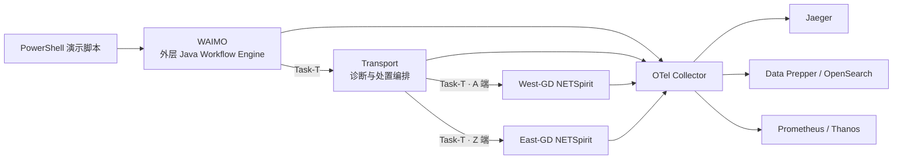

# 企业专线投诉处理可观测 Demo

## 目标

用一次跨地市企业专线 SLA 劣化投诉，串起 **Java Workflow Engine 执行分层 PSOP、A2A-T 任务提示词生成/校验、MockAgent 处理、Observability Java SDK 产生三类信号**。WAIMO 加载 7 步顶层 PSOP；Transport 收到诊断任务后加载 12 步子 PSOP，并编排 West/East OMC。投诉、诊断、授权、抢通和 SLA 数据均使用固定测试数据。

当前目录提供三种传输模式。默认 `memory` 模式用内存 client 快速离线回归；`http` 模式在同一 JVM 内启动四个带独立 AgentCard 的 HTTP MockAgent；`run-four-jvm.ps1` 通过同一套 classpath 启动 WAIMO、Transport、West、East 四个独立 JVM。HTTP 路径使用官方 A2A Java REST handler 和 Workflow Engine 的 `DefaultWorkflowEngineClient` 完成真实 HTTP 请求。所有模式都经过 Task-T client/server 校验和 Observability SDK 埋点；报告记录 transport、Agent URL、引擎历史和 Agent 处理记录。

分层角色、指标基线和验收条件见 [`docs/LAYERED_PSOP_REFACTOR_PLAN.md`](docs/LAYERED_PSOP_REFACTOR_PLAN.md)。
从 Agent 启动到 A2A-T 通信、执行引擎和 OTLP 上报的完整运行说明见
[`docs/DEMO_RUNTIME_GUIDE.md`](docs/DEMO_RUNTIME_GUIDE.md)。
本地 Prometheus、Thanos、Jaeger、OpenSearch 的 Web 入口和查询命令见
[`docs/LOCAL_STORAGE_VIEWING.md`](docs/LOCAL_STORAGE_VIEWING.md)。

## 当前实现状态

| 能力 | 当前状态 | 证据 |
| --- | --- | --- |
| PR #39 分层 PSOP | 已实现 | 16 步方案包、WAIMO 7 步 PSOP、Transport 12 步 PSOP；`ScenarioDefinitionTest` 校验三份资源 |
| Workflow Engine Java SDK | 已接入 | `ExecutePsop`、`ControlPoint`、`WorkflowEngineClient`、事件回调和 workflow observability |
| A2A-T Java SDK | 已接入 | `TaskTCodec` 通过 client orchestrator 生成提示词，再由 server orchestrator 校验；静态 LLM 只提供确定性响应 |
| MockAgent | 已实现（fixture + Python 互通探针） | `MockAgentRouter` 保证主流程确定性；`MockAgentInteropMain` / `run-mockagent-interop.ps1` 已对锁定的 Python MockAgent 完成 AgentCard、Task-T 和 A2A HTTP 回包验证 |
| Observability Java SDK | 已接入 | Workflow、step、Task-T client/server span、log、metric；`flush` 状态写入报告 |
| 运行证据 | 已实现 | `artifacts/<run_id>.json` 保存引擎历史、事件、Agent 记录和关联 ID |
| Collector/Jaeger/OpenSearch/Prometheus | 已验证（WSL2 Docker） | `scripts/start.ps1` 复用 SDK 的 local-storage Compose；Windows 找不到 Docker CLI 时自动转到 WSL Ubuntu，使用 `run.ps1 -EnableTelemetry` 导出 |
| HTTP A2A / 四角色 | 已实现（内嵌 HTTP） | `HttpMockAgentServer` 使用官方 A2A REST handler，`HttpDemoRuntime` 连接四个 AgentCard；`-Transport http` 可运行成功和拒绝路径 |
| 四 JVM / 独立进程 | 已实现 | `RoleMain`、`LayeredTransportWorkflow`、`start-four-jvm.ps1`、`stop-four-jvm.ps1`、`verify-multiprocess.ps1`；WAIMO→Transport→OMC 的 success/authorization-denied 已完成端到端验收 |
| 存储查询原始证据 | 已验证 | `verify-storage.ps1` 保存 `artifacts/<run_id>.storage.json`；WSL2 local-storage 已查到 Metric、Trace、Log |
| 宿主 API | 已实现（单 JVM） | `HostMain` 提供 `POST /runs`、`GET /runs/{run_id}`、`GET /healthz` 和 `POST /admin/shutdown`；`run-host.ps1` 提供验收入口 |
| Python MockAgent 互通 | 已实现探针 | `scripts/run-mockagent-interop.ps1` 在隔离 venv 中启动 `openan-demo/mockagent` gateway，并通过 Java A2A client 发送 Task-T |

### 离线运行

首次运行前需要将锁定的 Observability SDK 和 Workflow Engine 安装到本地 Maven 仓库。`bootstrap.ps1` 按 `sdk-lock.json` 下载并依次构建两者；Workflow Engine 暂时锁定到 [PR #109](https://github.com/project-openan/workflow-engine-sdk-java/pull/109) 的 fork 提交。

```powershell
Set-Location <observability-center-clone>\complaint-observability-demo
.\scripts\bootstrap.ps1
.\scripts\run.ps1 -Case success -RunId complaint-success-001
.\scripts\verify.ps1 -Case success -RunId complaint-success-001
.\scripts\run.ps1 -Case authorization-denied -RunId complaint-denied-001
.\scripts\verify.ps1 -Case authorization-denied -RunId complaint-denied-001
```

验证 HTTP A2A 路径：

```powershell
.\scripts\run.ps1 -Case success -RunId complaint-http-success-001 -Transport http
.\scripts\verify.ps1 -Case success -RunId complaint-http-success-001 -Transport http
.\scripts\run.ps1 -Case authorization-denied -RunId complaint-http-denied-001 -Transport http
.\scripts\verify.ps1 -Case authorization-denied -RunId complaint-http-denied-001 -Transport http
```

脚本默认关闭 OTLP 导出，便于没有 Collector 时验证业务链路；这不代表没有创建观测信号。启动本地存储后可以打开导出：

```powershell
.\scripts\start.ps1
.\scripts\run.ps1 -Case success -RunId complaint-storage-001 -Transport http -EnableTelemetry
.\scripts\verify-storage.ps1 -Case success -RunId complaint-storage-001
.\scripts\stop.ps1
```

`artifacts/complaint-storage-001.json` 中的 `otelFlush=true` 只说明 SDK 在截止时间内完成 flush；存储端是否收到数据需要按 local-storage README 的 Trace、Log、Metric 查询验证。

在本机 Windows 环境中，`start.ps1` 会优先使用 Windows Docker CLI；检测不到时自动调用 WSL2 Ubuntu 内的 Docker Compose，并保持临时 WSL 会话，避免 WSL 空闲回收正在运行的容器。停止时使用同样的 `stop.ps1` 清理容器和会话。也可以显式指定发行版：

```powershell
.\scripts\start.ps1 -WslDistro Ubuntu
.\scripts\stop.ps1 -WslDistro Ubuntu
```

当前已用 `wsl-storage-success-20261126` 和 `wsl-storage-denied-20261126` 完成两条路径的存储验收；两次均查到 Metric、Trace、Log，原始查询保存在对应的 `.storage.json` 文件中。

四个独立 JVM 的演示入口：

```powershell
.\scripts\run-four-jvm.ps1 -Case success -RunId complaint-four-success-001
.\scripts\run-four-jvm.ps1 -Case authorization-denied -RunId complaint-four-denied-001
```

Linux 使用原生 Bash 入口，不依赖 PowerShell 或 WSL。安装 JDK 17、Maven、Python 3、`curl` 和 Docker Compose 后，执行：

```bash
chmod +x scripts/linux/*.sh
scripts/linux/start-storage.sh
ENABLE_TELEMETRY=true scripts/linux/run-four-jvm.sh success complaint-linux-four-001
scripts/linux/stop-storage.sh
```

`run-four-jvm.sh` 会启动 West、East、Transport、WAIMO 四个 JVM，等待 AgentCard，运行并验收成功或授权拒绝分支，再以 HTTP shutdown 停止角色进程。`start-storage.sh` 与 `stop-storage.sh` 直接调用 Linux Docker Compose。

脚本会先构建运行时 classpath，按顺序等待四张 AgentCard 就绪，工作流结束后通过 `/admin/shutdown` 让各角色写出
`artifacts/<run_id>.<role>.json`。`verify-multiprocess.ps1` 会检查七步/五步终态、跨 JVM 的诊断并发窗口、授权拒绝分支和各角色记录。

宿主 API 入口：

```powershell
.\scripts\run-host.ps1 -Case success -RunId complaint-host-success-001 -Transport http
```

手工调用时先启动 `HostMain`，再向 `POST /runs` 发送
`{"case":"success","runId":"host-001","transport":"http"}`，轮询
`GET /runs/host-001` 直到返回业务报告，最后调用 `POST /admin/shutdown`。

验证真实 Python MockAgent：

```powershell
.\scripts\run-mockagent-interop.ps1 -InstallDependencies -RunId complaint-mockagent-interop-001
```

首次运行会在 `target/mockagent-venv` 安装锁定 MockAgent 的依赖；之后可以省略
`-InstallDependencies`。该探针验证真实 AgentCard、Task-T 提示词、A2A `message:send` 和数据集回包，
主投诉工作流仍使用 Java fixture 以保持 success/authorization-denied 的可重复验收。

## 源码基线

| 来源 | 用法 |
| --- | --- |
| [PR #39 的分层 PSOP](https://github.com/project-openan/observability-sdk-java/pull/39) 和场景说明 | 业务基线。全链路方案包 16 步；WAIMO 视角 7 步；Transport 视角 12 步。 |
| [PR #30 的 ConsumerComplaintHandling](https://github.com/project-openan/observability-sdk-java/blob/11326ed5532454312ee17ddbefaa6be121bcfe0b/consumer-smoke/src/main/java/net/openan/observability/consumer/ConsumerComplaintHandling.java) | 信号和展示参考。样例直接创建客户端与服务端 span，耗时使用常量。Demo 的信号从引擎回调和各进程的真实收发与处理产生。 |
| [MockAgent](https://github.com/project-openan/openan-demo/tree/main/mockagent) | Python/FastAPI 实现。`run-mockagent-interop.ps1` 启动锁定版本的 gateway，Java 侧用 A2A client + Task-T 发送探针请求；主流程的确定性分支仍由 Java fixture 承担。 |
| [Workflow Engine Java SDK](https://github.com/project-openan/workflow-engine-sdk-java) | `ExecutePsop`、`ControlPoint`、`WorkflowEngineClient` 和传输层。 |
| [A2A-T Java SDK](https://github.com/project-openan/a2a-t-sdk-java/tree/main/a2a-t-sample) | 参考服务端、任务消息及 AgentCard 示例，首版使用 Task-T。 |
| [Observability Java SDK](https://github.com/project-openan/observability-sdk-java) | Workflow、A2A/A2A-T 和 Agent 信号定义，统一 OTLP 导出。 |

## 目标拓扑和当前拓扑

目标阶段仍按四个角色拆分：



`memory` 模式把四个角色压缩在一个 JVM：Workflow Engine 的外层任务由 `InMemoryWorkflowEngineClient` 接收，`MockAgentRouter` 在同一进程执行 Transport、West 和 East 的固定逻辑。`http` 模式仍由一次 `DemoMain` 启动，但会创建四个独立 TCP HTTP server、四张 AgentCard 和两个 A2A transport：Workflow Engine → WAIMO/Transport，Transport → West/East。每个 HTTP server 使用官方 `RestHandler`、任务存储和 AgentExecutor；Transport 的诊断子任务通过 `HttpWorkflowEngineClient` 实际发出 HTTP 请求。运行报告可看到四个 URL、`nested-task-http` 记录和两端重叠窗口。

四 JVM 路径使用同一个 Maven 应用和同一套运行时依赖，通过角色参数启动四个进程。WAIMO 运行 PSOP，Transport、West、East 暴露 AgentCard 和 A2A 服务。Transport 作为子流程宿主，拥有两端诊断的真实出站调用。四个角色使用稳定的 `service.name`：`complaint-waimo`、`complaint-transport`、`complaint-west`、`complaint-east`。脚本把本机 AgentCard 地址注入调用方，随后从调用方进程验证可达性和任务终态。

| 计划路径 | 内容 |
| --- | --- |
| `pom.xml`、`src/main/java/` | 应用入口、Workflow Engine 回调、MockAgent、A2A-T 编解码和观测接入。 |
| `docs/IMPLEMENTATION_PLAN.md` | 详细实现方案、当前里程碑和 HTTP/多 JVM 后续拆分计划。 |
| `src/main/resources/scenario/` | 来自 PR #29 的可执行 PSOP。 |
| `src/main/resources/a2at/` | Task-T SDK 环境配置；演示使用静态 LLM，不访问外部模型。 |
| `src/main/resources/mockagent/agent-mapping.json` | 将 PR #29 的 Agent/skill 名称映射到 openan-demo/mockagent 的 AgentCard；当前逻辑仍由 Java fixture 执行。 |
| `sdk-lock.json`、`.vendor/` | SDK 来源和本地构建提交；`.vendor/` 默认忽略。 |
| `scripts/` | bootstrap、启动存储、执行和验收脚本，使用 PowerShell 7。 |
| `artifacts/<run_id>.json` | 本地运行报告，加入忽略规则。 |

## 工作流实现

原 PSOP 的同一步内可能同时列出规划、执行和汇总任务。保留原文件，并维护 Demo 执行版与上游 `step`、子任务 UUID 的映射。先用引擎直接解析原 PSOP，检查子任务调度、条件路由、Agent 解析与 `end` 终止行为。对存在先后依赖的子任务，在执行版显式拆分依赖；对同技能的诊断和抢通，使用结构化操作字段分派。对外结果按原七个阶段聚合，Trace 可以展示额外调度节点。

| 阶段 | 实际执行和输出 |
| --- | --- |
| step1 投诉受理 | WAIMO 本地回调读取固定投诉工单，输出工单 ID、专线 ID 和 A/Z 端标识。 |
| step2 投诉识别 | WAIMO 输出专线 SLA 劣化分类，带入投诉症状及 SLA 基线。 |
| step3 定界定位 | WAIMO 合成业务状态、路由及告警数据，得出传输大网问题。按 Agent 与技能从本地卡片映射解析 Transport。路由读取结构化定界结果。 |
| step4 根因定位 | WAIMO 调 Transport。Transport 根据两端标识选择 West 和 East，用 Java 引擎执行诊断子流程，让 A/Z 端远程任务并发，等待两端完成后再汇总。West 回主故障与建议，East 回排查结果；Transport 返回故障位置及处置建议。 |
| step5 问题处置 | WAIMO 根据根因发起处置；Transport 请求 West 返回模拟授权，成功后再请求模拟抢通，最后回报结果。授权拒绝时记录失败并停止，执行回调与后续阶段均不得进入。 |
| step6 修复验证 | Transport 读取固定 SLA 恢复序列，比较带宽、时延、丢包阈值，在限定次数内给出验证结果并回传 WAIMO。 |
| step7 投诉报结 | WAIMO 在 SLA 校验成功后模拟客户确认并报结，输出工单终态。 |

 - WAIMO 用 `ExecutePsop` 启动，按 SDK 业务回调处理本地步骤、任务输入和路由，消费事件流并以引擎终态形成运行报告。`memory` 模式使用 `InMemoryWorkflowEngineClient`；`http` 模式使用 `HttpDemoRuntime` 装配 `DefaultWorkflowEngineClient` 和四张 AgentCard。两种模式的诊断 A/Z 分支都在独立 executor 中并发，汇总等待两端终态后生成。
 - `TaskTCodec` 负责提示词生成和校验。每个远程任务先由 A2A-T client 生成符合专线投诉模板的提示词，再由 server 侧校验；`StaticLlmClient` 根据 JSON schema 返回固定结果，因此没有外部模型依赖。HTTP 模式只替换 A2A 的 socket I/O，消息体和扩展 URI不变。
- 请求业务数据包含 `run_id`、工单、上游步骤/子任务标识和操作输入，字段放在 SDK 支持的结构化内容中。每次运行保留独立关联 ID；区分 PSOP 定义 ID、引擎执行 ID、静态子任务 UUID、协议运行时 task/context ID 和 trace ID。
- 局部依赖使用前一步实际输出构造。例如授权结果必需且绑定本次操作，根因汇总必需两端结果，报结必需 SLA 校验通过。固定回包按角色、技能和操作选择，意外输入返回明确错误。首版用本地卡片映射模拟注册中心，通过 Task-T 承载模拟授权和上报，后续可以独立接入 Authorization-T、Notification-T 或真实注册中心。

## 信号和存储

1. **引擎观测。** 复用引擎已有的 [WorkflowObservability](https://github.com/project-openan/workflow-engine-sdk-java/blob/main/workflow-engine/src/main/java/dev/openan/workflow/engine/observability/WorkflowObservability.java)。给引擎提供宿主进程的 `Observability` 实例。当前报告已验证外层 workflow、七个 step、任务状态和失败路由事件；同一事件由引擎统一生成。
2. **A2A-T 与 A2A。** 两种模式都通过 A2A-T client/server facade 完成提示词生成、槽位提取和语义校验；MockAgentRouter 为每次任务创建 Task-T client/server span、log 和 metric。`http` 模式额外通过官方 A2A Java `RestTransport`、`RestHandler`、AgentCard 和 Task 状态完成真实 HTTP 交互；传输层使用受限 Windows 主机可运行的 `HttpURLConnection` 实现，业务协议仍由 SDK 解析和生成。
3. **跨线程和跨进程上下文。** `DemoMain`/WAIMO 入口先创建一个 `a2at.workflow` parent span，再启动 `ExecutePsop`。Workflow Engine 的异步 dispatch 线程拿不到 Java 当前上下文时，内存 client 和 `SocketA2AJavaClientRuntime` 使用这个 parent；嵌套任务则按 `task_id` 保存调用方 span，在 SDK worker 线程中恢复。若线程上已有有效 span，则继续使用当前 span。HTTP 出站 `HttpURLConnection` 注入 W3C `traceparent`，服务端 AgentExecutor 入口用 Observability SDK 提取，所以 engine workflow/step 与 A2A client/server/nested span 会处于同一条 trace。角色报告分别保存业务记录，根报告保存四张 AgentCard URL。`verify-storage.ps1` 还会读取 Jaeger 完整 trace，检查 span 的 `parentSpanId` 都能在同一 trace 中找到，并确认 root workflow 到 A2A client 的连接。 [Java 传播示例](https://github.com/project-openan/observability-sdk-java/blob/main/examples/src/main/java/net/openan/observability/example/TaskTHttpExample.java)
4. **Agent 观测。** 在业务处理入口测耗时，终态按实际返回记录成功或异常。对照锁定版本的 `workflow.yaml`、`a2at.yaml`、`agent.yaml` 确认信号名、字段与单位，记录源码名到存储查询名的映射。Trace 和 Log 关联 `run_id` 或 `trace_id`；Metric 用稳定的服务、场景、步骤和状态维度，通过执行前后的增量验收。信号只带场景字段、状态和关联标识。
5. **导出和查询。** 每 JVM 一个 SDK 实例，统一 OTLP/gRPC；用 [SDK 本地存储栈](https://github.com/project-openan/observability-sdk-java/tree/main/deploy/local-storage) 的路由作为基线。Jaeger 查 Trace，Data Prepper → OpenSearch 查 Log，Prometheus/Thanos 查 Metric。启动先等依赖就绪，运行后按 deadline 轮询存储，结束时限时 flush/close 且保留错误。存储使用 Compose 数据卷，验收时保留查询原始 JSON。

## 开发顺序与验收

| 顺序 | 实现任务 | 通过条件 |
| --- | --- | --- |
| 1. 依赖和互通探针 | 检查 Workflow Engine POM；本次读取到 `a2a.t.sdk.version=1.1.1`、A2A Java SDK `1.2.0.Final`、Observability `0.1.0-SNAPSHOT`。固定提交记录在 `sdk-lock.json`，用 `bootstrap.ps1` 安装 Workflow Engine snapshot。 | 本地构建通过；Task-T client/server 校验通过；运行报告保留 workflow、task、context 和错误关联字段。 |
| 2. 运行七个阶段 | 接入 PR #29 PSOP、MockAgent fixture、并发诊断、授权分支与运行报告。 | 成功报告七个阶段完成，A/Z 记录窗口重叠，汇总在两端终态之后；拒绝授权在 step5 结束。 |
| 3. 对齐观测 | 使用现有 SDK 生命周期埋点，接入本地 Collector/存储作为可选环境。 | 离线、内嵌 HTTP、四 JVM 模式确认 `otelFlush`；WSL2 local-storage 中，`verify-storage.ps1` 已用 success/authorization-denied 两条路径确认 Trace、Log、Metric，并保存原始 JSON。 |
| 4. 自动化演示 | 提供 `start.ps1`、`run.ps1`、`run-four-jvm.ps1`、`verify.ps1`、`verify-multiprocess.ps1` 和 `stop.ps1`。 | 两种 case 在 memory/http/四 JVM 路径返回零；报告文件和每角色报告可复查。 |

HTTP 运行入口由 `HostMain` 提供；四 JVM 脚本仍适合检查独立进程。单次演示按顺序执行，查询 Metric 时先取基线，以免把之前的运行计入本次验收。每次运行保存业务响应、引擎事件摘要、任务关联和验收结果。业务终态和存储验收结果分别记录，便于区分执行失败和信号缺失。

