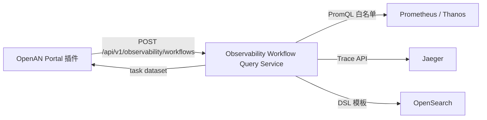

# Observability Workflow Query Service

面向 OpenAN Portal 的统一只读查询服务。它把 Prometheus、Jaeger 和 OpenSearch 的各自查询协议收敛为 Workflow 视图；Trace 与 Log 响应保持 OTLP 结构，Portal 不直接访问三类存储，也不保存其账号或地址。

## 第一阶段范围

- 以 `runId` 为 Workflow 资源主键，返回 Workflow 列表、详情、Trace、Log 和 Metric；
- 详情返回 PSOP 原始结构；
- Trace 返回 OTLP `ExportTraceServiceRequest`；
- Log 返回 OTLP `LogRecord`；
- Metric 返回白名单聚合后的 Workflow 指标；
- 故障时返回分数据源状态，避免把“部分数据暂不可用”显示成“任务不存在”。

不包含写入、删除、原始 PromQL / DSL 透传、跨租户聚合和鉴权对接；这些需要 Portal 的身份与租户模型明确后再加入。

## 服务边界



## 接口

完整定义见 [openapi.yaml](openapi.yaml)。首批接口：

| 方法 | 路径 | 说明 |
| --- | --- | --- |
| `GET` | `/healthz` | 服务及三类数据源连通性 |
| `POST` | `/api/v1/observability/workflows` | 查询 Workflow 列表 |
| `GET` | `/api/v1/observability/workflows/{runId}` | 查询 Workflow 详情，`steps` 为 PSOP 结构 |
| `POST` | `/api/v1/observability/workflows/{runId}/trace` | 查询 OTLP Trace |
| `POST` | `/api/v1/observability/workflows/{runId}/logs` | 查询 OTLP Log |
| `POST` | `/api/v1/observability/workflows/{runId}/metrics` | 查询 Workflow Metric |

详情响应保留 `sourceStatus` 字段：`ready`、`empty`、`unavailable` 或 `partial`。只有三类查询均成功且数据完整时，Workflow 详情的 `partial` 为 `false`。

## 本地启动

后端是独立的 Python 工程，与前端 npm 工具链分离，使用 uv 或 pip 启动：

```powershell
# 方式一：uv（推荐，自动管理虚拟环境）
cd observability-query-service
uv run observability-query-service

# 方式二：pip
pip install -e observability-query-service
observability-query-service
```

默认监听 `127.0.0.1:8787`，并读取 `complaint-observability-demo/artifacts` 中的 Demo 运行报告。先运行 Demo 并保留报告，列表和详情才能找到对应运行；仅有存储数据时不会自动发现运行，报告目录不存在时列表为空、详情返回 404。可用 `PORT` 和下方环境变量调整配置。通过反向代理访问时，请在代理侧配置访问控制。

Trace ID 优先来自对应的 `.storage.json` 报告，否则通过 OpenSearch 中精确匹配 `run_id` 的日志查找。缺少关联数据时 Trace 返回空；不会按时间猜测。PSOP 按 workflow ID 从 Demo 的 scenario 文件查找，找不到时返回 `null` 并标记 `partial`。

指标使用报告中的服务名和运行时间窗口查询 Prometheus。指标通常是服务级累计序列，可能包含同一服务的其他运行，不能视为单次运行的精确值；响应的 `collection.scope` 标为 `service`，指标响应标记为 `partial`。日志和 Trace 也依赖 Demo 已上报对应的关联字段。

列表、详情和 `/healthz` 会检查各数据源连通性。日志、Trace、指标接口在对应数据源不可用时返回 `partial` 和 `sourceStatus`。HTTPS 使用系统证书验证；使用私有 CA 时需要将 CA 加入运行环境的信任库。

## 代码结构

```text
pyproject.toml                包定义、入口命令（uv / pip 通用）
observability_query_service/  Python 包
  server.py                   HTTP 路由和请求响应处理
  service.py                  查询编排、过滤、分页和排序
  repository.py               运行报告读取及三类存储查询
  models/                     响应模型
    workflow.py               Workflow 摘要、详情、PSOP 和聚合
    trace.py                  OTLP ExportTraceServiceRequest
    log.py                    OTLP LogRecord
    metric.py                 Metric、信号和图表
```

## 数据源配置

服务从环境变量读取地址和认证信息；密钥不进入前端包和 Git：

```text
OBS_PROMETHEUS_URL=http://prometheus:9090
OBS_JAEGER_URL=http://jaeger-query:16686
OBS_OPENSEARCH_URL=https://opensearch:9200
OBS_OPENSEARCH_INDEX=a2at-logs-v2
OBS_QUERY_TIMEOUT_MS=5000
OBS_ARTIFACT_DIR=../complaint-observability-demo/artifacts
```

默认地址为本机 Demo 的端口：Prometheus `19090`、Jaeger `16686`、OpenSearch `19200`。当前实现面向本地 Demo，无内置存储认证配置；需认证的数据源可通过受控的本地代理接入。Trace 的 include 选项、日志的 category、时间偏移和 cursor，以及指标的 dim 和 includeCharts 尚未实现；日志最多返回前 200 条。
